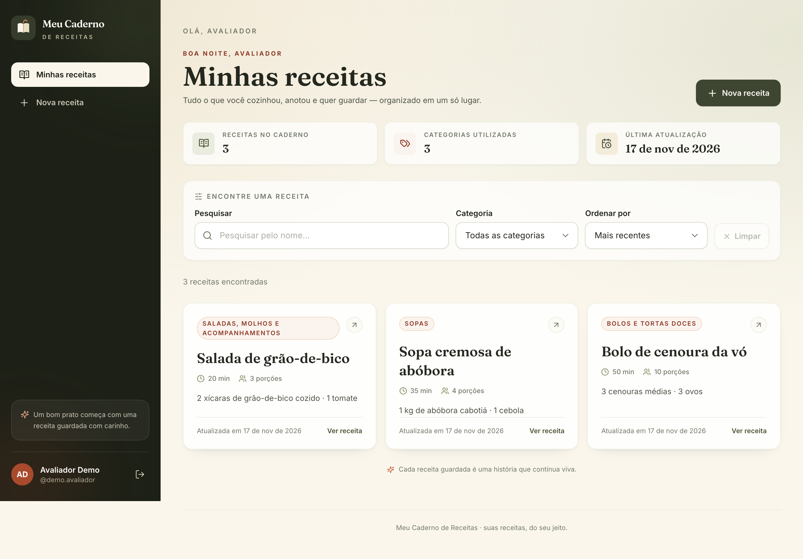
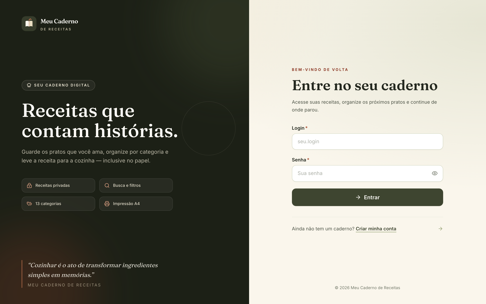
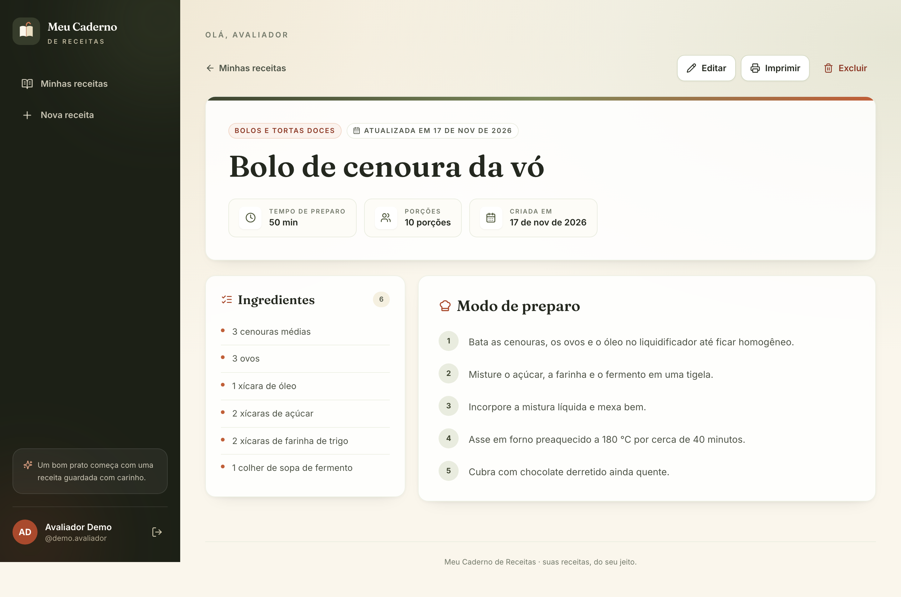
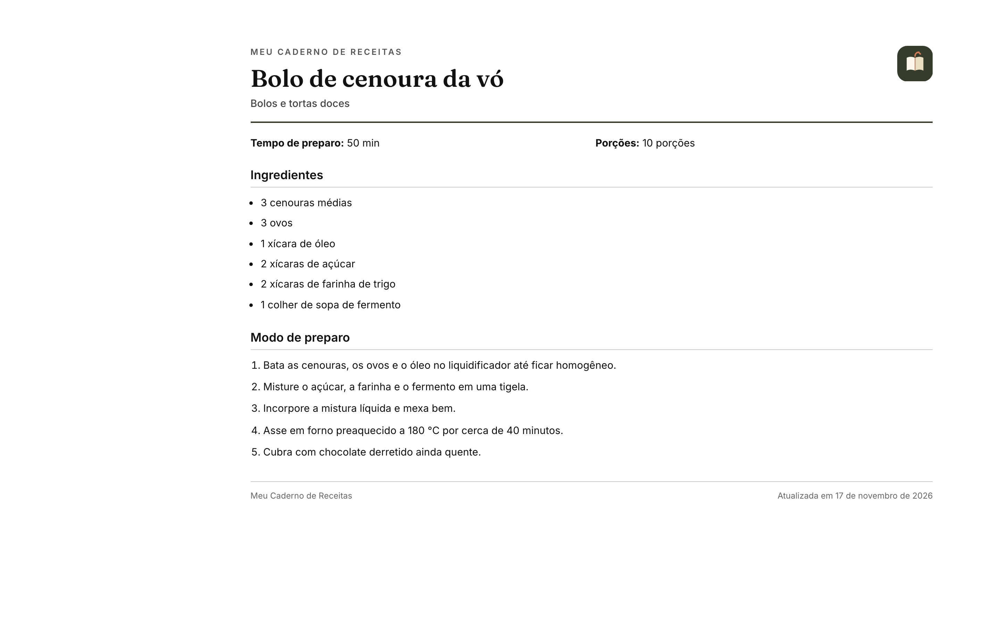
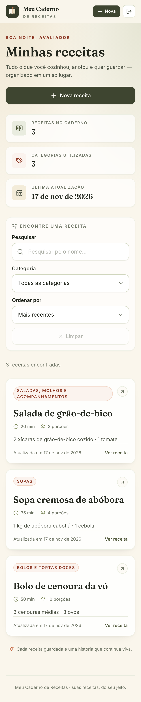

# Meu Caderno de Receitas

Aplicação completa de caderno de receitas: cada pessoa cria sua conta, guarda suas próprias
receitas, pesquisa, filtra, imprime em A4 e mantém tudo privado. Projeto entregue para o desafio
técnico **RG Receitas Culinárias**.



## Sumário

- [Visão geral](#visão-geral)
- [Stack](#stack)
- [Como rodar com Docker](#como-rodar-com-docker)
- [Como rodar em desenvolvimento](#como-rodar-em-desenvolvimento)
- [URLs](#urls)
- [Funcionalidades](#funcionalidades)
- [API](#api)
- [Banco de dados](#banco-de-dados)
- [Testes](#testes)
- [Decisões técnicas](#decisões-técnicas)
- [Estrutura do projeto](#estrutura-do-projeto)
- [Limitações e próximos passos](#limitações-e-próximos-passos)
- [Roteiro de demonstração](#roteiro-de-demonstração)

## Visão geral

O **Meu Caderno de Receitas** foi construído com React no frontend (conforme orientação atual do
desafio), NestJS/TypeScript no backend e MySQL 8.4 com TypeORM. O schema original recebido
(`referencias/script.sql`) foi preservado: mesmas tabelas, colunas, índices, chaves estrangeiras e
as 13 categorias iniciais. Não há `synchronize: true` nem tabelas/colunas adicionais.

A experiência foi desenhada para parecer um caderno de cozinha: paleta oliva, creme e terracota,
tipografia editorial (Fraunces + Inter), cartões de papel, microinterações discretas e uma versão
de impressão limpa em A4.

| Login | Detalhe | Impressão A4 |
| --- | --- | --- |
|  |  |  |

Versão mobile:



## Stack

| Camada | Tecnologias |
| --- | --- |
| Frontend | React 18.3, TypeScript 5.9, Vite 6.4, React Router 6.30, Tailwind CSS 3.4, Lucide, `@fontsource` |
| Backend | NestJS 11, TypeScript 5.9, TypeORM 0.3.31, class-validator, bcryptjs, JWT (`@nestjs/jwt`), Helmet, Swagger |
| Banco | MySQL 8.4, utf8mb4, schema original do desafio |
| Infra | Docker Compose (MySQL + API + Nginx), healthchecks |
| Testes | Jest, Supertest, Playwright (Chromium) |
| Qualidade | ESLint (flat config), Prettier, build TypeScript em modo estrito |

## Como rodar com Docker

Pré-requisitos: Docker Desktop (ou Docker Engine + Compose v2) e portas `3000`, `3306` e `8080`
livres.

```bash
cp .env.example .env
docker compose up -d --build
```

Aguarde os healthchecks (o MySQL inicializa o schema e as 13 categorias na primeira execução).

| Serviço | URL |
| --- | --- |
| Aplicação | <http://localhost:8080> |
| API | <http://localhost:3000/api> |
| Swagger UI | <http://localhost:3000/api/docs> |
| OpenAPI JSON | <http://localhost:3000/api/docs-json> |
| Healthcheck | <http://localhost:3000/api/health> |
| MySQL | `localhost:3306`, banco `teste_receitas_rg_sistemas` |

Credenciais padrão de desenvolvimento (defina outras no `.env`):

```text
MySQL root: root / root
Aplicação:  receitas / receitas_dev
```

> As credenciais acima servem apenas para avaliação local. Em produção, troque
> `MYSQL_ROOT_PASSWORD`, `MYSQL_PASSWORD` e `JWT_SECRET` por valores aleatórios.

Para parar:

```bash
docker compose down          # mantém os dados
docker compose down -v       # remove o volume e recria o banco do zero
```

## Como rodar em desenvolvimento

### 1. Banco

```bash
cp .env.example .env
docker compose up -d mysql
```

### 2. Backend

```bash
cd backend
cp .env.example .env
npm ci
npm run start:dev
```

O backend lê `backend/.env` e conecta em `127.0.0.1:3306` com o usuário `receitas`.

### 3. Frontend

```bash
cd frontend
cp .env.example .env
npm ci
npm run dev
```

O Vite serve em <http://localhost:5173> e encaminha `/api` para `http://localhost:3000`.

## URLs

| Ambiente | Frontend | API | Swagger |
| --- | --- | --- | --- |
| Docker Compose | <http://localhost:8080> | <http://localhost:3000/api> | <http://localhost:3000/api/docs> |
| Desenvolvimento | <http://localhost:5173> | <http://localhost:3000/api> | <http://localhost:3000/api/docs> |

## Funcionalidades

### Autenticação e sessão

- Cadastro com nome, login único (normalizado para minúsculas) e confirmação de senha.
- Senha armazenada somente como hash bcrypt (10 rounds); nunca retornada pela API.
- Login com JWT assinado, expiração configurável (`JWT_EXPIRES_IN_SECONDS`, padrão 1 hora).
- Rotas privadas protegidas por guard global; apenas `register`, `login` e `health` são públicos.
- Logout no cliente com descarte do token e redirecionamento.
- Sessão expirada: o cliente limpa o token, avisa por toast e volta ao login.
- Redirecionamento de volta para a página pedida após autenticar.

### Receitas

- CRUD completo, sempre restrito ao dono do token.
- Listagem paginada com pesquisa por nome, filtro por categoria e ordenação
  (mais recentes, mais antigas, atualizadas recentemente, nome A–Z/Z–A).
- Busca e filtros persistidos na URL (compartilhável e compatível com voltar/avançar).
- Resumo do caderno: total de receitas, categorias utilizadas e última atualização.
- Detalhe com ingredientes em lista, modo de preparo numerado e metadados.
- Confirmação antes de excluir, com estado de carregamento.
- Estados de carregamento (skeletons), erros com retry, vazio e “nenhum resultado”.
- Aviso de receita inexistente ou de outro usuário sem revelar a existência dela.
- Impressão A4 via `@media print`, com layout dedicado e quebra de página controlada.

### Categorias

- As 13 categorias originais vêm do script SQL, em ordem alfabética.
- Categoria é obrigatória na API e no formulário (validação de negócio), embora a coluna original
  aceite `NULL`. Essa escolha evita receitas sem classificação e não altera o schema.

### Interface

- Layout responsivo com sidebar no desktop, cabeçalho compacto no mobile.
- Identidade visual autoral (oliva/creme/terracota) e fontes auto-hospedadas.
- Formulários com validação em tempo real, mensagens por campo e erros da API.
- Toasts para sucesso e falha; diálogo acessível para exclusão.
- Foco visível, `skip link`, rótulos associados, `aria-*` e navegação por teclado.

## API

Base: `/api`. Todas as rotas de receitas e categorias exigem `Authorization: Bearer <token>`.

### Auth

| Método | Rota | Descrição |
| --- | --- | --- |
| `POST` | `/api/auth/register` | Cria a conta, já autentica e devolve o token (201). |
| `POST` | `/api/auth/login` | Autentica e devolve o token (200). |
| `GET` | `/api/auth/me` | Retorna o usuário autenticado, sem senha. |
| `POST` | `/api/auth/logout` | Encerra a sessão no cliente (JWT stateless). |

Resposta de autenticação:

```json
{
  "accessToken": "eyJhbGciOiJIUzI1NiIs...",
  "tokenType": "Bearer",
  "expiresIn": 3600,
  "user": { "id": 1, "nome": "Maria Silva", "login": "maria.silva", "criadoEm": "2026-11-17T12:00:00.000Z" }
}
```

### Receitas

| Método | Rota | Descrição |
| --- | --- | --- |
| `GET` | `/api/recipes` | Lista paginada do usuário autenticado. |
| `GET` | `/api/recipes/stats` | Totais do caderno. |
| `GET` | `/api/recipes/:id` | Detalhe de uma receita do usuário. |
| `POST` | `/api/recipes` | Cria uma receita (201). |
| `PATCH` | `/api/recipes/:id` | Atualiza campos enviados. |
| `DELETE` | `/api/recipes/:id` | Exclui (204). |

Parâmetros de listagem:

| Parâmetro | Tipo | Padrão | Regras |
| --- | --- | --- | --- |
| `page` | inteiro | `1` | `>= 1` |
| `limit` | inteiro | `9` | `1..50` |
| `search` | texto | — | até 100 caracteres; busca por nome |
| `categoriaId` | inteiro | — | `>= 1` |
| `sortBy` | enum | `criadoEm` | `nome`, `criadoEm`, `alteradoEm` |
| `order` | enum | `desc` | `asc`, `desc` |

Corpo de criação/edição (camelCase na API, snake_case no banco):

```json
{
  "nome": "Bolo de cenoura",
  "categoriaId": 1,
  "tempoPreparoMinutos": 45,
  "porcoes": 8,
  "ingredientes": "3 cenouras\n3 ovos\n2 xícaras de farinha",
  "modoPreparo": "Bata tudo e asse por 40 minutos."
}
```

### Categorias

| Método | Rota | Descrição |
| --- | --- | --- |
| `GET` | `/api/categories` | Lista as 13 categorias. |

### Saúde

| Método | Rota | Descrição |
| --- | --- | --- |
| `GET` | `/api/health` | Executa `SELECT 1` no MySQL e retorna o estado. |

### Formato de erro

```json
{
  "statusCode": 400,
  "error": "Bad Request",
  "message": "Dados inválidos.",
  "errors": ["O nome da receita deve ter entre 1 e 45 caracteres."],
  "path": "/api/recipes",
  "timestamp": "2026-11-17T12:00:00.000Z"
}
```

Erros de autorização e validação são padronizados por um filtro global. Receitas de outro usuário
retornam **404** (e não 403) para não revelar a existência do registro.

## Banco de dados

O script `database/init/01-schema.sql` é executado pelo container MySQL na primeira inicialização.
Ele preserva o schema original:

- `usuarios`: `id`, `nome`, `login` (único), `senha`, `criado_em`, `alterado_em`.
- `categorias`: `id`, `nome` (único).
- `receitas`: `id`, `id_usuarios`, `id_categorias`, `nome`, `tempo_preparo_minutos`, `porcoes`,
  `modo_preparo`, `ingredientes`, `criado_em`, `alterado_em`.
- Chaves estrangeiras `fk_receitas_1` (RESTRICT/CASCADE) e `fk_receitas_2` (CASCADE/CASCADE),
  índices e collation `utf8mb4_0900_ai_ci`.

As 13 categorias: Alimentação Saudável, Aves, Bebidas, Bolos e tortas doces, Carnes, Doces e
sobremesas, Lanches, Light, Massas, Peixes e frutos do mar, Prato Único, Saladas/molhos/acompanhamentos,
Sopas.

Como o schema original não define `DEFAULT CURRENT_TIMESTAMP` nas datas, o backend preenche
`criado_em`/`alterado_em` na aplicação (`@BeforeInsert`/`@BeforeUpdate`). Nenhuma coluna foi
adicionada. `synchronize` permanece `false`.

## Testes

### Unitários (Jest)

```bash
cd backend
npm test
```

Cobrem autenticação (hash bcrypt, login, conflito, usuário removido), regras de receitas
(ownership, validação de categoria, atualização, exclusão) e validação dos DTOs.

### Integração (Jest + Supertest + MySQL real)

```bash
docker compose up -d mysql
cd backend
npm run test:integration
```

O `globalSetup` recria o banco `teste_receitas_rg_sistemas_test` a partir do **mesmo SQL** do
Docker (substituindo apenas o nome do schema), garantindo constraints e categorias reais. Os testes
exercitam o pipeline HTTP completo e incluem o cenário **Usuário A x Usuário B**: B recebe 404 ao
tentar ler, editar e excluir uma receita de A. Também conferem no banco que a senha é um hash bcrypt,
que `%`/`_` não viram curingas de busca e que IDs inválidos retornam mensagem em português.

Credenciais padrão: `root`/`root` em `127.0.0.1:3306`. Para outro MySQL, defina `DB_HOST`,
`DB_PORT`, `DB_USER`, `DB_PASSWORD` e `DB_NAME` no ambiente.

### E2E (Playwright)

```bash
cd frontend
npx playwright install chromium
npm run test:e2e
```

O fluxo cobre: cadastro → criação de receita → pesquisa → resultado vazio → limpar filtros →
paginação fora do intervalo → detalhe → edição → acionamento da impressão → exclusão com confirmação
→ logout → rota privada redirecionando para o login.

Por padrão o Playwright sobe backend e frontend de desenvolvimento. Para testar o pacote Docker:

```bash
docker compose up -d --build
cd frontend
E2E_BASE_URL=http://localhost:8080 npm run test:e2e
```

### Resultados desta entrega

| Verificação | Resultado |
| --- | --- |
| `backend npm test` | 3 suítes, 23 testes aprovados |
| `backend npm run test:integration` | 1 suíte, 14 testes aprovados |
| `frontend npm run test:e2e` (dev) | 1 fluxo aprovado |
| `E2E_BASE_URL=http://localhost:8080 npm run test:e2e` | 1 fluxo aprovado no Docker/Nginx |
| `backend npm run lint:check` | sem erros |
| `frontend npm run lint` | sem erros |
| `backend npm run build` | aprovado |
| `frontend npm run build` | aprovado |
| `docker compose up -d --build` | MySQL, API e frontend saudáveis |

## Decisões técnicas

1. **React em vez de Vue.** O repositório original usava Vue, mas a orientação atual do desafio
   pede React. A interface foi reconstruída em React, mantendo o schema e os contratos da API.
2. **Schema versionado como SQL de inicialização.** Em vez de gerar tabelas pelo TypeORM, o schema
   original é aplicado por `database/init/01-schema.sql`. Isso preserva exatamente colunas, índices e
   FKs e elimina o risco de `synchronize` alterar o banco. `synchronize: false` é explícito.
3. **Datas na aplicação.** O schema não tem defaults para `criado_em`/`alterado_em`; os valores são
   definidos por hooks das entidades, sem alterar o banco.
4. **Autorização por escopo de consulta.** Toda busca, edição e exclusão inclui `id_usuarios` na
   cláusula `WHERE`. O serviço nunca carrega uma receita de outro dono para depois negar acesso.
5. **404 em vez de 403.** Evita vazamento de existência de receitas alheias.
6. **JWT stateless.** O logout é do cliente; o servidor não mantém blacklist. É uma limitação
   consciente, documentada no Swagger e neste README.
7. **Busca com `LOCATE`.** Evita que `%` e `_` digitados sejam interpretados como curingas de
   `LIKE`; a collation do MySQL mantém a busca case-insensitive.
8. **Contratos em camelCase.** A API expõe `categoriaId`, `tempoPreparoMinutos`, `criadoEm` etc.,
   enquanto as colunas permanecem `id_categorias`, `tempo_preparo_minutos`, `criado_em`.
9. **Categoria obrigatória na API.** Decisão de negócio para evitar receitas sem classificação;
   não houve alteração de schema.
10. **Frontend sem biblioteca de estado.** Context API para autenticação e toasts, `fetch` nativo e
    URL como fonte de verdade dos filtros. Menos dependências e comportamento previsível.
11. **Nginx no container do frontend.** O proxy `/api` evita CORS no pacote Docker e permite abrir
    frontend e Swagger no mesmo host, com fallback de SPA para o React Router.
12. **Acessibilidade e impressão como requisitos de primeira classe.** `@media print` tem folha
    dedicada, oculta navegação e preserva a receita em A4.

## Estrutura do projeto

```text
.
├── database/init/01-schema.sql      # schema original + 13 categorias
├── docker-compose.yml               # MySQL, API e frontend com healthchecks
├── .env.example                     # variáveis do Compose
├── referencias/                     # arquivos originais recebidos (script, PDF, DER)
├── docs/
│   ├── RELATORIO-ENTREGA.md         # relatório técnico da entrega
│   └── screenshots/                 # capturas reais da aplicação
├── backend/
│   ├── src/
│   │   ├── auth/                    # login, cadastro, JWT, guards
│   │   ├── users/                   # entidade e serviço de usuários
│   │   ├── categories/              # entidade e listagem de categorias
│   │   ├── recipes/                 # CRUD, busca, filtros, estatísticas
│   │   ├── common/                  # filtro global, decorators, DTOs
│   │   └── config/                  # validação de ambiente e Swagger
│   └── test/                        # integração com MySQL real
└── frontend/
    ├── e2e/recipes.spec.ts          # fluxo Playwright completo
    ├── src/
    │   ├── api/                     # client fetch e serviços
    │   ├── components/              # layout, UI e receitas
    │   ├── contexts/                # Auth e Toast
    │   ├── pages/                   # login, cadastro, lista, formulário, detalhe
    │   └── lib/                     # validação, formatação, erros
    ├── nginx.conf                   # SPA + proxy /api
    └── Dockerfile                   # build Vite + runtime Nginx
```

## Limitações e próximos passos

- **Logout stateless:** o token continua válido até expirar. Para revogação imediata seriam
  necessários refresh tokens/blacklist (fora do escopo).
- **Sem rate limiting:** login e cadastro não têm proteção contra força bruta nesta versão.
- **Sem recuperação de senha, upload de imagens, refresh token ou multiusuário colaborativo.**
- **Impressão depende do navegador:** o layout A4 foi validado em Chromium; pequenas diferenças de
  margem podem ocorrer em outros navegadores.
- **Categorias são fixas:** não há CRUD de categorias, pois o desafio fornece as 13 iniciais.
- **Token em `localStorage`:** escolha simples para o desafio; em produção, cookies `HttpOnly`
  com CSRF seriam preferíveis.

## Roteiro de demonstração

1. **Abrir <http://localhost:8080>** e mostrar a tela de login.
2. **Criar uma conta** em “Criar minha conta”, destacando validação e login automático.
3. **Criar uma receita** com nome, categoria, tempo, porções, ingredientes e modo de preparo.
4. **Voltar à lista**, pesquisar por um termo e filtrar por categoria; limpar filtros.
5. **Abrir o detalhe**, editar o nome e salvar.
6. **Clicar em Imprimir** e mostrar a prévia A4 sem menus.
7. **Excluir** a receita e confirmar o diálogo.
8. **Sair** e tentar abrir `/` novamente para mostrar a proteção de rota.
9. **Abrir o Swagger** em <http://localhost:3000/api/docs>, autenticar com o token e listar receitas.
10. **Mostrar os testes** (`npm test`, `npm run test:integration`, `npm run test:e2e`).

---

Projeto desenvolvido para o desafio técnico RG Receitas Culinárias. Os arquivos originais enviados
foram preservados em `referencias/`.
