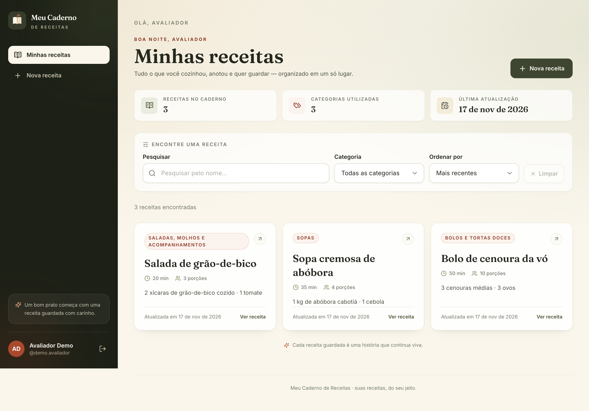
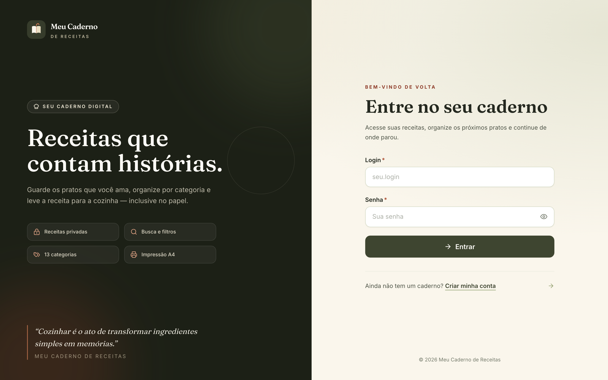
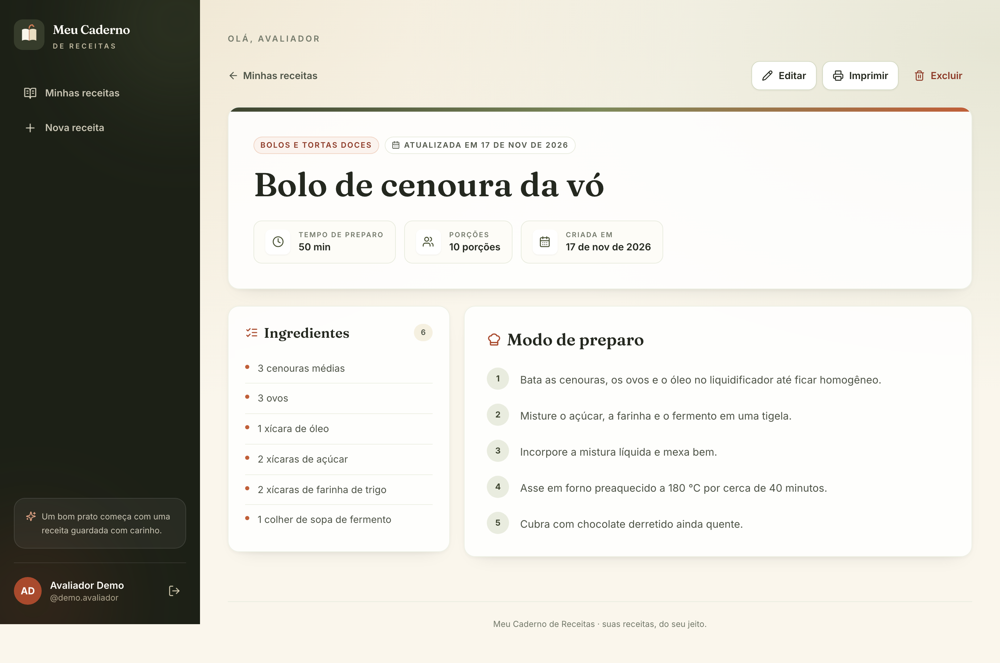
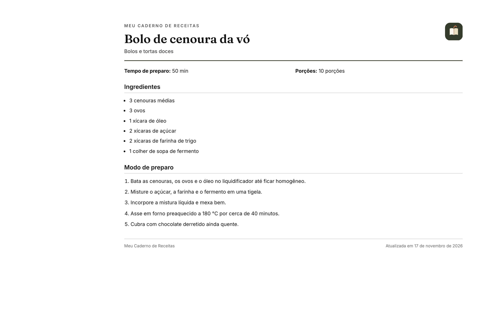

# Frontend — Meu Caderno de Receitas

Aplicação React do desafio **RG Receitas Culinárias**: caderno pessoal com autenticação, CRUD de
receitas, pesquisa, filtros, paginação, responsividade e impressão A4.

> Projeto independente: `package.json`, lockfile, `.env.example`, `.gitignore`, `.dockerignore`,
> `Dockerfile`, `nginx.conf` e este README. A API NestJS está em `../backend`. A raiz do monorepositório também contém `.github/` e o README geral.



## Sumário

1. [Apresentação](#1-apresentação)
2. [Tecnologias](#2-tecnologias)
3. [Arquitetura](#3-arquitetura)
4. [Organização de diretórios](#4-organização-de-diretórios)
5. [Decisões técnicas](#5-decisões-técnicas)
6. [Pré-requisitos](#6-pré-requisitos)
7. [Instalação](#7-instalação)
8. [Variáveis de ambiente](#8-variáveis-de-ambiente)
9. [Integração com a API](#9-integração-com-a-api)
10. [Execução](#10-execução)
11. [Funcionalidades](#11-funcionalidades)
12. [Autenticação e rotas protegidas](#12-autenticação-e-rotas-protegidas)
13. [Formulários, estados e erros](#13-formulários-estados-e-erros)
14. [Testes](#14-testes)
15. [Build, lint e formatação](#15-build-lint-e-formatação)
16. [Responsividade e impressão](#16-responsividade-e-impressão)
17. [Capturas de tela](#17-capturas-de-tela)
18. [Problemas comuns](#18-problemas-comuns)
19. [Limitações conhecidas e avaliação](#19-limitações-conhecidas-e-avaliação)
20. [Deploy na Vercel](#20-deploy-na-vercel)

---

## 1. Apresentação

Cada usuário cria sua conta, guarda receitas, pesquisa, filtra, edita, exclui e imprime em A4. A
identidade visual remete a um caderno de cozinha: paleta oliva/creme/terracota, tipografia editorial
(Fraunces + Inter) e cartões com aspecto de papel.

A URL mantém `?search=`, `?category=` e `?page=`, permitindo compartilhar filtros e usar
voltar/avançar do navegador. A ordenação usa `?sortBy=` (`name`, `createdAt`, `updatedAt`) e
`?order=` (`asc`, `desc`).

## 2. Tecnologias

| Categoria | Tecnologia |
| --- | --- |
| UI | React 18.3 + TypeScript 5.9 (modo estrito) |
| Build/dev server | Vite 6.4 |
| Rotas | React Router 7.18 |
| Estilos | Tailwind CSS 3.4 + PostCSS/Autoprefixer |
| Ícones | Lucide React |
| Fontes | `@fontsource` (auto-hospedadas) |
| HTTP | `fetch` nativo com client tipado |
| Estado | Context API (Auth e Toast) + URL para filtros |
| Testes de componentes | Vitest + Testing Library + jsdom |
| Testes E2E | Playwright (Chromium) |
| Qualidade | ESLint (flat config) + Prettier |

## 3. Arquitetura

- SPA com React Router; não há renderização no servidor.
- `src/api/client.ts` centraliza `fetch` com credenciais, CSRF em memória, `ApiError` e o evento de
  sessão expirada; `services.ts` expõe `authApi`, `categoriesApi` e `recipesApi`.
- `AuthProvider` controla restauração de sessão, login, cadastro, logout e expiração; `ToastProvider`
  centraliza mensagens acessíveis.
- Páginas orquestram dados; componentes de UI e de receitas são reutilizáveis.
- Tipos em `src/types` espelham o contrato da API, com identificadores em inglês (`name`,
  `categoryId`, `preparationTimeMinutes`, `createdAt`). Os nomes físicos do MySQL continuam
  originais e são mapeados no backend por `field`/`tableName`.
- Requisições concorrentes usam `AbortController`; respostas antigas são descartadas após troca de
  filtros ou rota.

## 4. Organização de diretórios

```text
frontend/
├── src/
│   ├── api/                   # client fetch, ApiError, serviços por domínio
│   ├── components/
│   │   ├── layout/            # AppShell, AuthLayout, Logo, rotas protegidas
│   │   ├── recipes/           # RecipeCard, filtros, estatísticas
│   │   └── ui/                # Button, Modal, Pagination, EmptyState, campos
│   ├── contexts/              # AuthProvider e ToastProvider
│   ├── hooks/                 # useAuth, useToast, debounce, título
│   ├── lib/                   # validação, formatação, erros, cn
│   ├── pages/                 # Login, Cadastro, Lista, Formulário, Detalhe, 404
│   ├── test/                  # setup do Vitest/Testing Library
│   └── types/                 # contratos da API e formulários
├── e2e/                       # fluxo Playwright
├── screenshots/               # capturas usadas neste README
├── public/
├── Dockerfile                 # build Vite + Nginx
├── nginx.conf                 # fallback SPA + proxy /api
├── vite.config.ts
├── vitest.config.ts
└── playwright.config.ts
```

## 5. Decisões técnicas

1. **React + Vite.** Build rápido e configuração enxuta.
2. **Sem biblioteca de estado global.** Context API resolve autenticação/toasts; o restante é local
   ou vem da URL.
3. **`fetch` nativo com client tipado.** Erros HTTP viram `ApiError` com `status`, `message` e
   `errors`; o corpo de erro é validado antes do uso.
4. **Sessão em cookie HttpOnly.** O navegador nunca lê nem guarda o JWT; o client envia
   `credentials: 'include'` e o token CSRF recebido no JSON no header `X-CSRF-Token`.
5. **Proxy para manter a sessão no mesmo host.** O Vite encaminha `/api` para `VITE_PROXY_TARGET` em desenvolvimento; no Docker, o Nginx encaminha para `backend:3000`; na Vercel, os rewrites de `vercel.json` encaminham para a API pública. O navegador continua chamando `/api` no próprio host.
6. **Restauração silenciosa.** Um 401 em `/auth/me` resulta em estado anônimo sem toast de
   "sessão expirada"; o aviso global fica para requisições autenticadas em uso.
7. **Submissões protegidas.** Login, cadastro, criação/edição e exclusão possuem trava de envio
   duplicado.
8. **Impressão dedicada.** Folha `@media print` A4, sem navegação ou controles, com quebras
   controladas.
9. **Acessibilidade.** Skip link, foco visível, labels, `aria-*`, modal com armadilha de foco e
   navegação por teclado.

## 6. Pré-requisitos

- Node.js 22+ e npm 10+
- Backend em execução (local em `http://localhost:3000`; no Docker a API é publicada em `3001`)
- Para E2E: Chromium do Playwright (`npx playwright install chromium`)

## 7. Instalação

```bash
cd frontend
npm ci
cp .env.example .env
```

`npm install` também funciona em desenvolvimento; `npm ci` é o caminho de CI e instalação limpa.

## 8. Variáveis de ambiente

| Variável | Padrão | Descrição |
| --- | --- | --- |
| `VITE_API_URL` | `/api` | Base usada pelo navegador (proxy do Vite/Nginx). Valor em branco cai para `/api` |
| `VITE_PROXY_TARGET` | `http://localhost:3000` | Destino do proxy `/api` no `vite.config.ts`; utilizado somente em desenvolvimento, não é necessário no Vercel |
| `VITE_PORT` | `5173` | Porta do Vite em desenvolvimento |
| `VITE_PREVIEW_PORT` | `4173` | Porta do `vite preview` |

Se o backend local estiver em outra porta, ajuste `VITE_PROXY_TARGET` e reinicie o Vite. A porta
`3001` do Compose é somente para depuração do container; o Vite local continua usando `3000`. No
build Docker, `VITE_API_URL=/api` é passado como build arg e o Nginx resolve `backend:3000`.
Mantenha `/api`: os cookies de sessão usam `Path=/api`, sem `Domain`, e devem permanecer no mesmo
host do frontend (proxy do Vite ou do Nginx).

## 9. Integração com a API

- **Desenvolvimento:** Vite em `http://localhost:5173` encaminha `/api` para `VITE_PROXY_TARGET`.
- **Docker:** Nginx em `http://localhost:8080` (ou `FRONTEND_HOST_PORT`) encaminha `/api` para
  `http://backend:3000` na rede do Compose.
- O JWT é definido pelo backend no cookie `rg_auth` (`HttpOnly`, `Path=/api`, sem `Domain`); o
  frontend nunca o lê nem envia em header.
- Requisições que modificam dados (POST/PATCH/DELETE) recebem `X-CSRF-Token` a partir de `/auth/csrf`,
  `/auth/login`, `/auth/register` ou `/auth/me`.
- Contratos consumidos: `/auth/*`, `/categories`, `/recipes`, `/recipes/stats`, `/recipes/:id`.
- Respostas 401 em requisições autenticadas disparam `SESSION_EXPIRED_EVENT`, limpam a sessão e
  exibem aviso; a restauração inicial é silenciosa.

## 10. Execução

```bash
cd frontend
npm ci
cp .env.example .env
npm run dev
```

Abra <http://localhost:5173>. O backend local precisa estar ativo em `3000` — veja
`../backend/README.md`. Se a porta `3000` estiver ocupada, configure `PORT` no backend e
`VITE_PROXY_TARGET` aqui; não altere apenas um dos dois lados.

Stack completa em containers (executada a partir de `backend/`):

```bash
cd ../backend
docker compose --profile full up -d --build
cd ../frontend
```

Build local e pré-visualização (ainda em `frontend/`):

```bash
npm run build
npm run preview
```

## 11. Funcionalidades

- Cadastro com nome, login único e confirmação de senha; login automático após cadastro.
- Login, logout, restauração de sessão e redirecionamento de rotas privadas.
- CRUD completo de receitas, sempre isolado por usuário no backend.
- Listagem paginada com pesquisa por nome, filtro por categoria e ordenação.
- Filtros persistidos na URL; limpeza explícita e página fora do intervalo corrigida.
- Resumo do caderno: total de receitas, categorias usadas e última atualização.
- Detalhe com ingredientes em lista, modo de preparo e metadados.
- Confirmação acessível antes de excluir.
- Estados de carregamento, erro com retry, vazio e "nenhum resultado".
- Toasts de sucesso/erro e mensagens por campo nos formulários.
- Layout responsivo e impressão A4.

## 12. Autenticação e rotas protegidas

`AuthProvider` mantém `status` (`loading | authenticated | anonymous`) e `user`. Na abertura, remove
apenas a chave legada `meu-caderno:token` do `localStorage` (preservando qualquer outro dado) e
**sempre** chama `/auth/me`: é o cookie que determina se há sessão. Login/cadastro recebem o CSRF no
JSON; logout chama a API e limpa sempre o estado local. Se a revogação remota falhar, a interface
informa isso honestamente em vez de afirmar que a sessão foi encerrada no servidor. Há trava contra
logout e login duplicados.

| Rota | Acesso | Tela |
| --- | --- | --- |
| `/login` | Pública (redireciona se autenticado) | Login |
| `/register` | Pública (redireciona se autenticado) | Cadastro |
| `/` | Protegida | Lista de receitas |
| `/recipes/new` | Protegida | Formulário de criação |
| `/recipes/:id` | Protegida | Detalhe |
| `/recipes/:id/edit` | Protegida | Formulário de edição |
| `*` | Pública | 404 |

Rotas antigas (`/cadastro`, `/receitas/*`) redirecionam para as equivalentes em inglês.

`ProtectedRoute` guarda as rotas privadas e preserva a origem para redirect após login. O redirect é
validado como caminho interno (`/...`, nunca `//host`). `PublicOnlyRoute` impede acesso a login e
cadastro quando já autenticado.

## 13. Formulários, estados e erros

- **Carregando:** skeletons na lista, formulário e detalhe; spinner em ações.
- **Erro HTTP:** `ApiError` com mensagem amigável e botão de tentar novamente.
- **Lista vazia:** convite para criar a primeira receita; **sem resultados:** ação para limpar
  filtros.
- **Formulário de receita:** validação local, erros por campo, preservação dos valores em falha,
  trava de submissão duplicada e limpeza ao trocar entre "nova" e "editar" na mesma instância de rota.
- **Categorias:** falha no carregamento exibe erro inline com retry em vez de deixar o select
  silenciosamente vazio.
- **Exclusão:** modal de confirmação; falha mantém a tela e exibe erro, sucesso navega para a lista.
- **Sessão:** restauração silenciosa; aviso em 401 durante uso; logout sempre encerra o estado local.

## 14. Testes

```bash
npm test          # Vitest em modo run
npm run test:watch
```

Vitest + Testing Library + jsdom cobrem:

- formatação e validação (`src/lib`);
- paginação e cartão de receita, incluindo fallbacks;
- `api/client`: credenciais sem JWT, bootstrap de CSRF, remoção pontual da chave legada, erro de
  rede, payload inválido e notificação de expiração;
- `AuthProvider`: restauração expirada, logout com falha de API, evento 401 e logout duplicado;
- `LoginPage` e `RegisterPage`: validação, 401/409, preservação de dados, redirect seguro e submissão
  duplicada;
- `RecipeFormPage`: criação, edição, limpeza de estado entre rotas, erro da API e categories retry;
- `RecipesPage`: estado vazio, erro HTTP, paginação e filtro por categoria;
- `RecipeDetailPage`: conteúdo e disparo da impressão, exclusão com sucesso/falha, 404 e retry;
- guard do banco E2E do Playwright: host local, porta descartável, schema de teste e usuário.

Configuração em `vitest.config.ts` e setup em `src/test/setup.ts`.

### E2E com Playwright

O Playwright **nunca** usa o banco de desenvolvimento. A configuração exige MySQL em loopback,
porta diferente de `3306` (padrão `3310`) e schema `teste_receitas_rg_sistemas_playwright`.
Valores inseguros são recusados antes de iniciar qualquer servidor. Os servidores de teste
também não são reaproveitados: se `3010` ou `5173` estiverem ocupados, a execução falha em vez de
usar uma instância possivelmente ligada ao banco real. Se precisar de outra porta para o Vite, defina
`E2E_FRONTEND_URL` (por exemplo, `http://localhost:5174`); a origem do CORS é ajustada junto.

Fluxo local, com MySQL descartável em `tmpfs` (sem volume persistente):

```bash
# em frontend/
docker run -d --name receitas_e2e_mysql --rm --tmpfs /var/lib/mysql \
  -e MYSQL_ROOT_PASSWORD=root \
  -e MYSQL_DATABASE=teste_receitas_rg_sistemas_playwright \
  -p 3310:3306 mysql:8.4

npx playwright install chromium
npm run test:e2e

docker rm -f receitas_e2e_mysql
```

Se usar outro host, porta ou credenciais, defina `E2E_DB_HOST`, `E2E_DB_PORT`, `E2E_DB_USER`,
`E2E_DB_PASSWORD` e `E2E_DB_NAME` (somente nomes `teste_receitas_rg_sistemas_*_playwright|_e2e|_test`).
`E2E_BACKEND_URL` aponta a API usada pelos testes de replay/reinício (padrão `http://localhost:3010`);
`E2E_FRONTEND_URL` altera a origem do Vite e do CORS. No modo Docker, `E2E_BASE_URL` desliga os
`webServer`s e o guard local — por isso deve acompanhar as variáveis `E2E_DB_*` e
`E2E_BACKEND_URL` do overlay.

Os 20 fluxos validados no Chromium estão em `e2e/recipes.spec.ts`: cadastro, login, refresh,
criação, validação do formulário, listagem, pesquisa, filtro por categoria, ordenação, paginação,
detalhes, edição, impressão A4 (`window.print()` e regra `@page`), exclusão, logout, proteção de
rotas, CSRF com `403`/`201`, rate limiting com `429`, sessão e receitas após reinício real da API e
revogação persistida com `revoked_at` e replay do token retornando `401`. Os testes de 429 e de
reinício iniciam APIs temporárias em portas próprias; nenhum processo é encerrado pelo código de
produção.

Para validar a stack Docker, use o overlay de E2E — containers, portas e volume exclusivos:

```bash
# em frontend/
cd ../backend
JWT_SECRET='segredo-de-testes-com-32-caracteres-ou-mais' \
docker compose -f docker-compose.yml -f docker-compose.e2e.yml \
  -p receitas-e2e --profile full up -d --build --wait

cd ../frontend
E2E_BASE_URL=http://localhost:8091 \
E2E_BACKEND_URL=http://localhost:3011 \
E2E_JWT_SECRET=<o mesmo JWT_SECRET usado no compose> \
E2E_DB_HOST=127.0.0.1 E2E_DB_PORT=3311 \
E2E_DB_USER=root E2E_DB_PASSWORD=root \
E2E_DB_NAME=teste_receitas_rg_sistemas_playwright \
npm run test:e2e

cd ../backend
docker compose -f docker-compose.yml -f docker-compose.e2e.yml \
  -p receitas-e2e --profile full down -v
cd ../frontend
```

O overlay `backend/docker-compose.e2e.yml` não é carregado pelos comandos padrão. Com o `-p
receitas-e2e`, containers, rede e volume (`receitas-e2e_mysql_e2e_data`) ficam isolados; o volume é
removido apenas por `down -v`. Não há nomes fixos de container no Compose, inclusive neste overlay.

## 15. Build, lint e formatação

```bash
npm run lint          # ESLint
npm run format        # Prettier --write
npm run format:check  # Prettier --check
npm run build         # tsc --noEmit + vite build
```

O build gera `dist/`, servido pelo Nginx no container.

## 16. Responsividade e impressão

- Sidebar no desktop e cabeçalho compacto no mobile; grade de receitas de 1 a 3 colunas.
- Alvos de toque e tipografia ajustados para telas pequenas.
- O botão **Imprimir** aguarda as fontes (quando disponíveis) e chama `window.print()`.
- `@media print` em `src/index.css`: folha A4, oculta navegação/botões/toasts, remove sombras e
  fundos, preserva título, tempo, porções, ingredientes e modo de preparo, controla quebras de
  página e mantém o cabeçalho/rodapé do caderno.
- Validado em Chromium; margens podem variar levemente em outros navegadores.

## 17. Capturas de tela

| Login | Detalhe | Impressão A4 |
| --- | --- | --- |
|  |  |  |

Versão mobile:


## 18. Problemas comuns

| Sintoma | Causa provável | Solução |
| --- | --- | --- |
| `[EADDRINUSE]` na 5173 | Outro Vite já usa a porta | Defina `VITE_PORT` no `.env` ou use `--port`; configure `E2E_FRONTEND_URL` se for E2E |
| `/api` retorna 404/502 | Backend não está rodando | Inicie o backend e confira `VITE_PROXY_TARGET` |
| `/api` falha no Vercel | Rewrite ausente/incorreto ou API indisponível | Confira `frontend/vercel.json` e o healthcheck pelo domínio do frontend |
| `ECONNREFUSED` no Vite | Porta do backend diferente | Ajuste `VITE_PROXY_TARGET` e reinicie `npm run dev` |
| Login funciona, lista falha | Sessão revogada/expirada | Faça login novamente; o app limpa a sessão em 401 |
| `403` ao salvar ou excluir | CSRF ausente/desatualizado | Recarregue a página e tente novamente |
| CORS no Docker | Origem não permitida | Ajuste `CORS_ORIGIN` no `../backend/.env` |
| E2E recusado por "porta 3306" | Configuração aponta para o MySQL de desenvolvimento | Suba a instância descartável na porta 3310 (ver §14) |
| Playwright sem navegador | Chromium não instalado | `npx playwright install chromium` |
| Página em branco após deploy | Falta fallback de SPA | Use o `nginx.conf` incluído (`try_files ... /index.html`) |
| Fonte diferente | Fontes auto-hospedadas não carregaram | Verifique `dist/assets` e o cache do navegador |

## 19. Limitações conhecidas e avaliação

Fora do escopo desta versão: renovação automática da sessão (refresh token), recuperação de senha,
upload de imagens, CRUD de categorias e snapshots visuais de impressão em múltiplos navegadores. A
revogação imediata, os cookies `HttpOnly` e o CSRF já estão implementados; o contador de
login/cadastro do backend é em memória por instância.

Rotas de avaliação:

| Serviço | URL (padrão) |
| --- | --- |
| Aplicação em desenvolvimento | <http://localhost:5173> |
| Aplicação em Docker (`--profile full`) | <http://localhost:8080> |
| API local | <http://localhost:3000/api> |
| API publicada pelo Docker | <http://localhost:3001/api> |
| Swagger local | <http://localhost:3000/api/docs> |
| Swagger no Docker | <http://localhost:3001/api/docs> |
| Healthcheck local | <http://localhost:3000/api/health> |
| Healthcheck no Docker | <http://localhost:3001/api/health> |

Roteiro rápido de demonstração: abrir a aplicação → criar conta → criar receita → pesquisar e
filtrar → abrir detalhe → editar → imprimir → excluir com confirmação → sair → tentar abrir `/` →
abrir Swagger e executar `GET /api/recipes`.

## 20. Deploy na Vercel

O frontend está publicado em:

**[Meu Caderno de Receitas — produção](https://rg-receitas-culinarias-oai3.vercel.app/login)**

O backend está publicado em [rg-receitas-culinarias.vercel.app](https://rg-receitas-culinarias.vercel.app/api/health)
e utiliza o TiDB Cloud Starter com TLS verificado.

### 20.1. Configuração do projeto

| Configuração Vercel | Valor |
| --- | --- |
| Repositório | `filipe-fragallo/RG-Receitas-Culinarias` |
| Branch de produção | `main` |
| Root Directory | `frontend/` |
| Framework Preset | Vite |
| Build Command | `npm run build` |
| Output Directory | `dist` |
| Variável `VITE_API_URL` | `/api` |

O frontend utiliza a **integração GitHub–Vercel** para publicar alterações na
`main`. As variáveis de ambiente são configuradas no projeto Vercel.
`VITE_PROXY_TARGET` **não precisa ser configurada na Vercel**: ela serve
somente ao proxy do `vite.config.ts` durante o desenvolvimento local.

### 20.2. Proxy da API e sessões

O arquivo `frontend/vercel.json` contém os rewrites reais:

```json
{
  "$schema": "https://openapi.vercel.sh/vercel.json",
  "rewrites": [
    {
      "source": "/api",
      "destination": "https://rg-receitas-culinarias.vercel.app/api"
    },
    {
      "source": "/api/:path*",
      "destination": "https://rg-receitas-culinarias.vercel.app/api/:path*"
    },
    {
      "source": "/(.*)",
      "destination": "/index.html"
    }
  ]
}
```

As duas primeiras regras encaminham as chamadas `/api` para o backend.
A terceira fornece o fallback de SPA para rotas como `/login`,
`/register` e `/recipes/:id`.

O navegador faz chamadas relativas para `/api`, usando o **domínio do
frontend**. Isso permite que os cookies `HttpOnly` com `Path=/api`,
sem `Domain` e com `Secure` em HTTPS, acompanhem as requisições
sem exigir acesso direto ao host do backend.

O backend deve permitir a origem
`https://rg-receitas-culinarias-oai3.vercel.app` em `CORS_ORIGIN`.
O endereço público da API não é um segredo: autenticação, autorização,
cookies e CSRF são validados pelo servidor.

### 20.3. Validação após publicar

1. Acesse [o healthcheck pelo domínio do frontend](https://rg-receitas-culinarias-oai3.vercel.app/api/health): deve retornar `status: ok` e `database: up`.
2. Abra [a tela de login](https://rg-receitas-culinarias-oai3.vercel.app/login) e cadastre um usuário.
3. Faça login, atualize a página e confirme que a sessão continua ativa.
4. Cadastre, pesquise, edite, imprima e exclua uma receita; finalize com logout.

### 20.4. Workflow manual alternativo

O repositório também possui `.github/workflows/production.yml`, com
operações explícitas para provisionar, migrar e publicar. O passo antigo
de substituição de `__BACKEND_VERCEL_HOST__` foi removido: o
`frontend/vercel.json` contém a URL estável do backend. O workflow
manual exige os secrets de publicação no GitHub Actions antes de ser usado.

O fluxo de publicação atualmente utilizado é a integração direta
GitHub–Vercel. Deploys do frontend não criam banco, não executam
migrations e não alteram os dados existentes.

---

Desenvolvido para o desafio técnico **RG Receitas Culinárias**.
